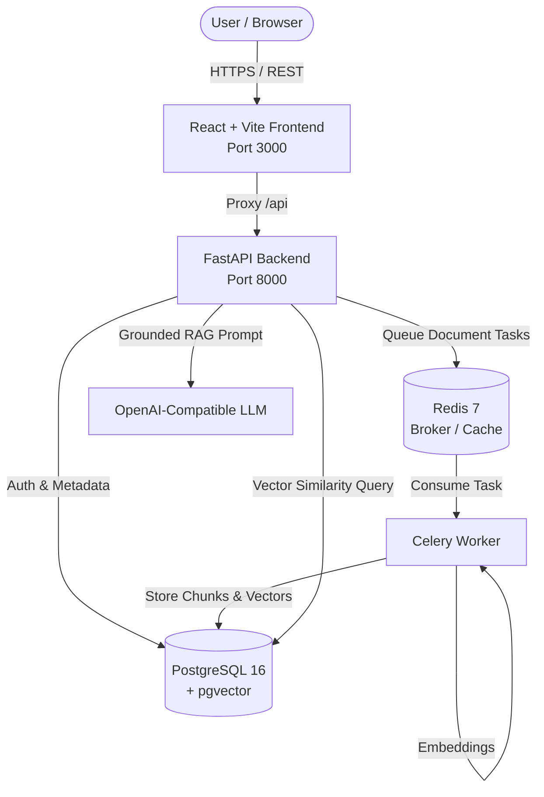

# 📄 AI Document Assistant (Enterprise RAG)

A production-grade, secure web application where users can authenticate, upload PDF and text documents, process them asynchronously with Celery and Redis, search content semantically using **PostgreSQL + pgvector**, and ask questions to receive **grounded answers with page-level citations**.

---

## 🚀 Features

- **JWT Authentication & Security**: Secure registration, login, logout, password strength validation, and role-based access control.
- **Strict Data Isolation**: All documents, chunks, conversations, and queries are strictly scoped to the authenticated owner.
- **Robust Text Extraction**: Extract PDF text with real page numbers via **PyMuPDF**, plus plain text (.txt) and Markdown (.md).
- **Intelligent Chunking & Embeddings**: Overlapping window chunking with position metadata; embeddings generated via `sentence-transformers` (`all-MiniLM-L6-v2`, 384 dimensions).
- **Semantic Search with pgvector**: High-performance cosine distance vector search inside PostgreSQL.
- **Grounded RAG Pipeline**: LLM prompts strictly instruct the model to answer only from retrieved context and refuse hallucinated answers if context is insufficient.
- **Auditable Source Citations**: Every answer provides page-level citations (Document ID, filename, page number, preview snippet).
- **Asynchronous Task Queue**: Celery workers powered by Redis handle heavy extraction and embedding pipelines without blocking API requests.
- **Modern Responsive Frontend**: React 18, TypeScript, Vite, React Router, Tailwind CSS, and Lucide icons.
- **Containerized**: Full Docker Compose setup for PostgreSQL/pgvector, Redis, FastAPI Backend, Celery Worker, and Frontend.

---

## 🏛️ System Architecture



---

## 📦 Tech Stack

- **Backend**: Python 3.12, FastAPI, SQLAlchemy 2 (Async), Alembic, Pydantic v2
- **Vector Database**: PostgreSQL 16 with `pgvector`
- **Asynchronous Tasks**: Celery, Redis
- **Embedding Model**: `sentence-transformers` (`all-MiniLM-L6-v2`)
- **PDF Extraction**: `PyMuPDF` (`fitz`)
- **Frontend**: React 18, TypeScript, Vite, Tailwind CSS, Lucide Icons, Axios
- **Testing & CI**: Pytest, Pytest-Asyncio, GitHub Actions

---

## ⚡ Quick Start with Docker Compose

1. **Clone the repository**:
   ```bash
   git clone https://github.com/gk-girishkumar/Ai-document-assistant.git
   cd Ai-document-assistant
   ```

2. **Configure environment variables**:
   ```bash
   cp .env.example .env
   # Edit .env and supply your secret key and optional LLM API key
   ```

3. **Start all services**:
   ```bash
   docker compose up --build
   ```

4. **Access the application**:
   - **Frontend UI**: [http://localhost:3000](http://localhost:3000)
   - **Backend API & Swagger Docs**: [http://localhost:8000/docs](http://localhost:8000/docs)
   - **Health Probe**: [http://localhost:8000/health](http://localhost:8000/health)

---

## 💻 Local Development Setup

### 1. Backend Setup

```bash
# Create Python virtual environment
python -m venv .venv
source .venv/bin/activate  # On Windows: .venv\Scripts\activate

# Install dependencies
pip install -r requirements.txt

# Run migrations
alembic upgrade head

# Start FastAPI server
uvicorn doc_assistant.app.main:app --reload --port 8000

# In a separate terminal, start the Celery worker
celery -A doc_assistant.workers.celery_app worker --loglevel=info
```

### 2. Frontend Setup

```bash
cd frontend
npm install
npm run dev
```

Visit [http://localhost:5173](http://localhost:5173) (or port 3000 when proxied).

---

## 🔌 API Endpoints Summary

| Method | Endpoint | Description |
|---|---|---|
| `POST` | `/api/auth/register` | Register new user account |
| `POST` | `/api/auth/login` | Log in and receive JWT token & HttpOnly cookie |
| `POST` | `/api/auth/logout` | Clear authentication session |
| `GET` | `/api/users/me` | Fetch authenticated user profile |
| `GET` | `/api/documents` | List current user's documents |
| `POST` | `/api/documents` | Upload PDF / TXT / MD document |
| `GET` | `/api/documents/{id}` | Get document metadata |
| `POST` | `/api/documents/{id}/process` | Queue background document processing |
| `DELETE` | `/api/documents/{id}` | Delete document, file, and embeddings |
| `GET` | `/api/documents/{id}/chunks` | List extracted chunks |
| `POST` | `/api/conversations` | Create a new conversation |
| `GET` | `/api/conversations` | List user's conversations |
| `GET` | `/api/conversations/{id}` | Get conversation and message history |
| `POST` | `/api/conversations/{id}/messages` | Send message and receive grounded RAG answer |
| `DELETE` | `/api/conversations/{id}` | Delete conversation |
| `GET` | `/health` | Liveness health probe |
| `GET` | `/ready` | Readiness probe verifying DB & Redis |

---

## 🧪 Testing

Run unit and integration test suite:

```bash
pytest -v
```

Run test suite with code coverage:
```bash
pytest --cov=doc_assistant --cov-report=term-missing
```

---

## 🔒 Security Measures

- **No Secrets in Source Control**: `.env` and uploaded files are excluded via `.gitignore`.
- **Role-Based Authorization**: Endpoints verify user identity and ownership before accessing documents or conversations.
- **Path Traversal Protection**: Uploaded files are renamed with UUIDs and isolated in designated directories.
- **SQL Injection Prevention**: Built entirely with SQLAlchemy ORM parameterized queries.
- **Safe Error Reporting**: Exception handlers sanitize internal error details from HTTP responses.

---

## 📜 License

MIT License. Designed and built for enterprise document intelligence.
